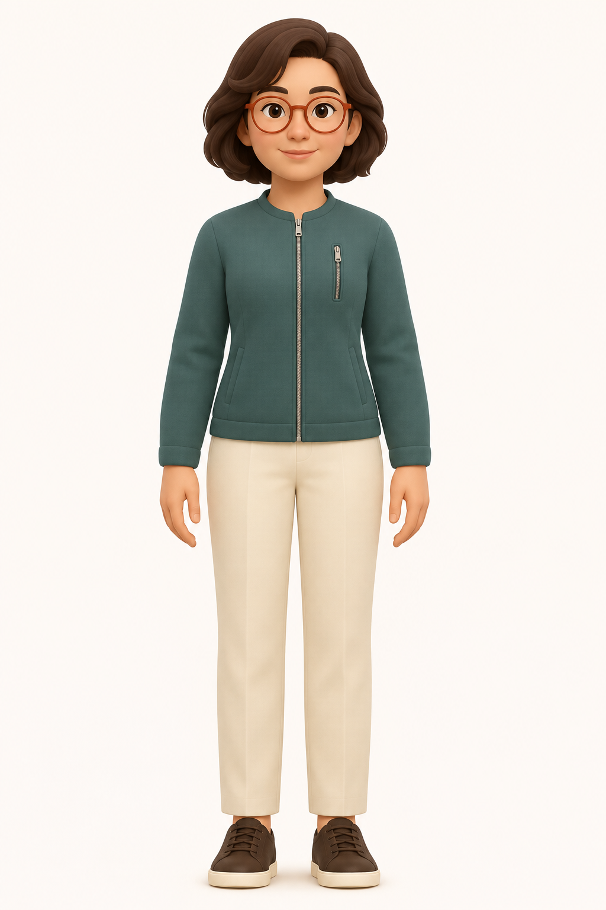
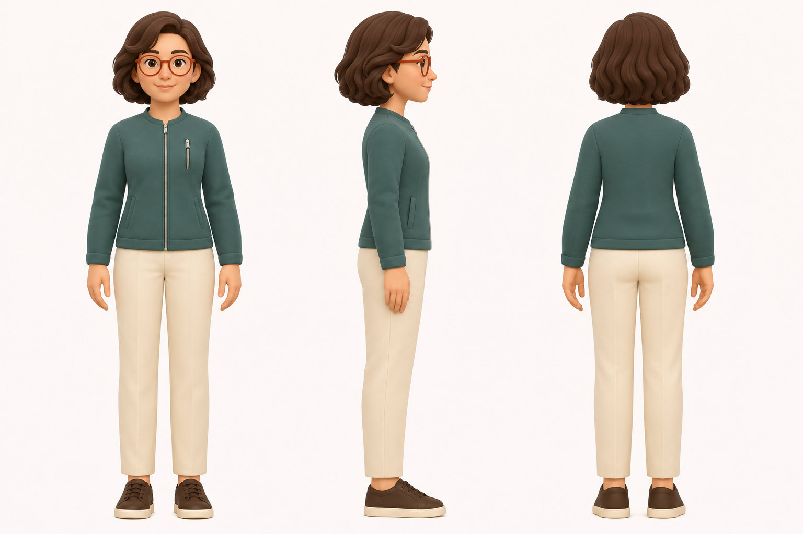
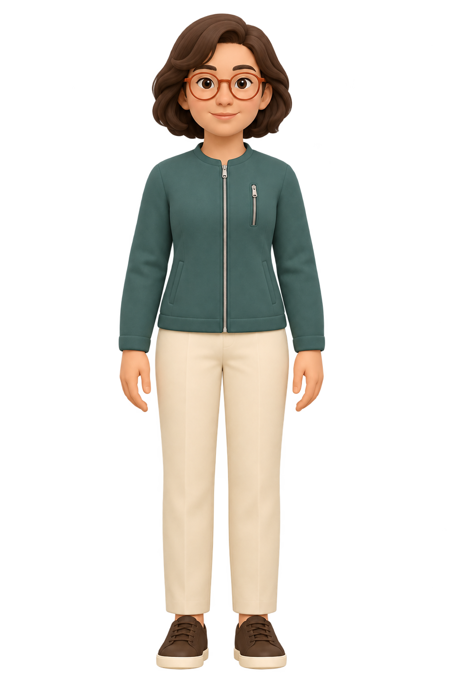

# 阿杜个人 IP 形象创建

把照片、已有角色图或文字设定，做成能用于头像、封面和讲解视频的个人 IP 角色包。

**先确定人物，再做多角度，最后记录怎么复用。** 本项目是可安装的 Agent Skill，调用你所用 AI 客户端的图像生成能力；不是独立生图软件，也不是三维建模程序。

## 能做什么

- 从照片提取可见特征，或从文字设计虚构人物。
- 先出正面预览，确认后制作正／侧／背三视图。
- 输出真正带透明像素的人物 PNG，便于放进视频或封面。
- 整理身份、服装、配色和不可变化项，供下次生图继续使用。
- 记录提示词、参考关系及实际检查结果，保留未解决的问题。

角色包只做用户需要的内容；只要头像时，不强制生成整套三视图。立体插画是二维图片，不会交付可旋转的 3D 模型。

## 运行条件和费用

需要支持 Agent Skills、图片查看和图片生成／编辑的 AI 客户端。Skill 文档没有额外 API、密钥或必装软件依赖；图像生成仍消耗所用客户端／模型服务的额度，费用由该服务决定。没有图像工具时只能得到方案和提示词，不能生成真实图片。

可选：有 Node.js 18+ 时运行随包的只读角色包检查器；没有时仍能使用主要工作流，由宿主完成文件检查。

## 安装

仓库：[aduaifc/adu-personal-ip](https://github.com/aduaifc/adu-personal-ip)。

下载仓库 ZIP 并解压，**把这个包含 SKILL.md 的文件夹安装为 `adu-personal-ip`**。不要只复制 README。

常见目录（以实际客户端的设置为准）：

| 客户端 | 示例位置 |
|---|---|
| Codex | `$CODEX_HOME/skills/adu-personal-ip/`；未设置时使用用户目录下 `.codex/skills/adu-personal-ip/` |
| Claude Code | 用户目录下 `.claude/skills/adu-personal-ip/` |
| 其他 Agent | 使用客户端指定的 Skills 目录，并保留相对文件结构 |

已经存在同名 Skill 时先备份或安装为独立新版本，避免覆盖改动。若客户端不支持 Skill，可直接提供 SKILL.md 与其引用文件作为任务指导；这不等于已完成安装。

## 开始使用

文字创建：

```text
使用 adu-personal-ip，帮我设计一个用于 AI 教程的虚构人物。
成年女性、短发、圆框眼镜，柔和立体插画风格。
先给我正面预览，确认后做三视图、透明全身 PNG 和角色设定。
```

照片创建（在支持图片的客户端附上有权使用的照片）：

```text
使用 adu-personal-ip，把这张我的照片做成知识讲解人物。
保留脸型、发型和眼镜，服装先给建议；照片不放进交付包。
```

已有角色继续使用：

```text
使用 adu-personal-ip，以附件角色作为身份参考。
保持脸型、发型和衣服，补严格侧面和背面，再给一张透明人物图。
```

如果你希望一次完成，可以明确说“由你决定未指定的设计细节，直接完成”。Skill 会记录为委托决定，不会写成你已经看图确认。

## 你会拿到什么

```text
ip-packs/角色标识/
  images/front.png
  images/turnaround.png
  images/cutout.png
  character.json
  character-spec.md
  generation-log.json
  review.md
```

实际结构随你请求的资产变化。下次生成时，把正面／三视图作为**实际图像参考**，同时提供角色说明；只念人物名字不能保证模型记得其长相。

可选文件检查（在仓库根目录执行）：

```bash
node scripts/check-pack.mjs examples/ahe
```

返回 JSON 及退出码。它能检测路径、缺文件、PNG 结构和透明像素，不能自动判断长相、衣服漂移或版权。检查器只读且不联网，不会修改你的角色包。

## 示例与验证

[阿禾完整示例](examples/ahe/character-spec.md)包含虚构角色的实际图片、提示词和检查记录。她只是测试人物，与你自己的 IP 无关。







实际验证范围、未验证项与已知局限见 [验证记录](docs/validation.md)。不承诺每次生成都不跑脸；细节漂移需要检查与针对性修正。照片输入仍会经过实际使用的图像服务处理，原照片不随角色包公开。

## 授权与来源

- Skill 代码和文档：[MIT](LICENSE)，版权署名阿杜 (Adu)。允许个人、商业、教学、修改及再分发，分发副本或实质内容时保留版权和许可声明。
- 仓库内虚构示例图片：[CC0 1.0](ASSETS.md)，在发布者有权处置的范围内开放使用。
- 用户照片和用户创建的角色：不自动采用本项目许可，由权利人决定。
- [创作与来源记录](ORIGIN.md)：本项目由阿杜委托 AI 辅助编写，未打包其他第三方 Skill 的文件或资产。

首次发布版本：1.0.0。后续修订记录见 [CHANGELOG](CHANGELOG.md)。
